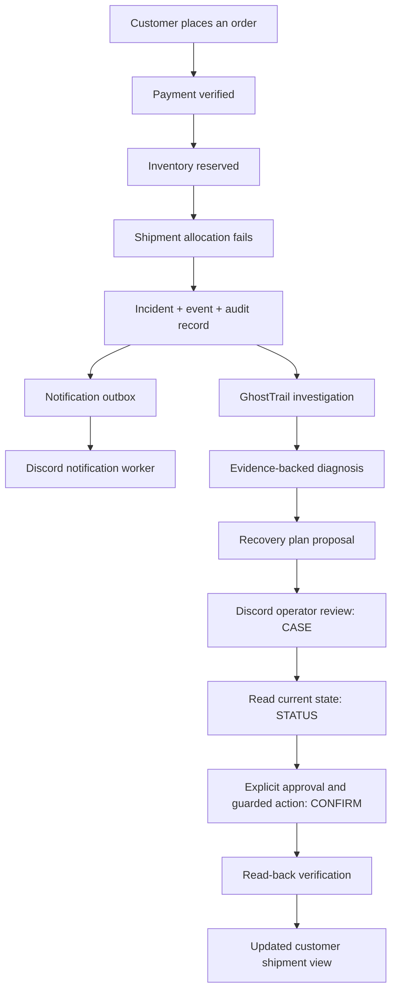
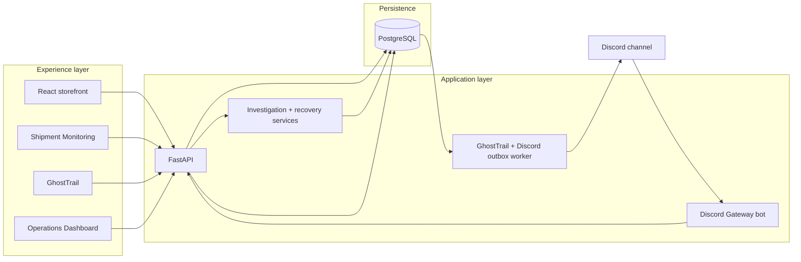

<div align="center">

# AFTERMATH AI

### Commerce doesn't stop at failure. Neither should recovery.

**An evidence-led commerce resilience platform that investigates broken order workflows, recommends safe recovery, and verifies the outcome before the customer is told everything is okay.**

[](https://fastapi.tiangolo.com/)
[](https://react.dev/)
[](https://www.postgresql.org/)
[](https://discord.com/)
[](https://www.python.org/)

[Overview](#-the-problem) · [How it works](#-how-aftermath-works) · [Features](#-inside-the-platform) · [Architecture](#-architecture) · [Run locally](#-run-it-locally) · [Limitations](#-scope--honest-limitations)

</div>

---

## ⚡ The problem

A customer pays. Inventory is reserved. Then the shipment service times out.

The checkout says *paid*. The warehouse workflow says *not shipped*. The customer sees uncertainty. The operations team has to piece together logs, database records, and messages before deciding what to do.

A blind retry can make things worse: duplicate shipments, inconsistent records, or a customer being told an order is fixed when it is not.

**Aftermath AI is built for this exact moment.**

It connects the evidence, reconstructs what happened, checks the current business state, prepares a controlled recovery, and verifies the result. Instead of treating failure as the end of a workflow, Aftermath treats it as a state that can be understood and safely resolved.

> **Our principle:** Never confuse an attempted action with a verified outcome.

## 🧭 How Aftermath works

The platform follows one connected operational loop:



### The six stages

| Stage | What happens |
|---|---|
| **01 — Detect** | A seeded shipment-allocation failure creates a persisted incident and event. |
| **02 — Investigate** | GhostTrail gathers the order, payment, inventory, shipment, event, and audit evidence available to the application. |
| **03 — Diagnose** | The system records an advisory diagnosis and prepares a recovery proposal. |
| **04 — Review** | Discord gives the operator a focused handoff to inspect the case and current state. |
| **05 — Recover** | An explicit confirmation triggers guarded, idempotent demo execution after precondition checks. |
| **06 — Verify** | The backend reads persisted state again before reporting the simulated recovery as complete. |

## ✨ Inside the platform

### 🛍️ Commerce storefront
- Five-product technology storefront with product availability.
- Interactive cart and quantity controls.
- Razorpay Test Mode checkout and server-side payment verification.
- Order and inventory records persisted in PostgreSQL.

### 🧭 GhostTrail AI — investigation workspace
- Investigation view for the seeded incident.
- Evidence gathered from persisted business records.
- Advisory diagnosis and recovery-plan proposal.
- A time-limited handoff to the Discord operations workflow.
- Clear separation between observed evidence and proposed action.

### 🛰️ Shipment Monitoring — customer experience
- Order-level shipment visibility and recorded event timeline.
- Purchased-product and order context.
- Recovery state reflected from backend records.
- Customer-facing status without exposing internal operator commands.

### 🎛️ Operations Dashboard
- Incident overview and incident detail.
- Recovery plans, persisted events, and audit history.
- Read-only monitoring surface with periodic refresh.
- Separate from customer-facing shopping and shipment pages.

### 🤖 Discord recovery control room
The Discord workflow is automated up to the decision point. When GhostTrail's ready notification is posted, the Gateway bot recognizes its own notification, automatically loads the case preview, and posts a fresh status snapshot in the thread. Operators do not need to type `CASE` or `STATUS` for the normal path.

| Command | Purpose |
|---|---|
| Automatic | Inspect the handoff and post current incident, approval, payment, shipment, and recovery-action state. |
| `CONFIRM <code>` | The only required operator command: explicitly approve and execute an eligible simulated recovery. |
| `CASE <code>` / `STATUS <code>` | Manual fallback if the automatic preview or status reply cannot be loaded. |

**Safety built into the demo path**
- Handoff codes expire after 60 minutes.
- Execution checks approval and business-state preconditions.
- Idempotency prevents a repeated confirmation from creating a duplicate recovery action.
- Audit records preserve the decision trail.
- A timeout is not treated as proof of failure: check `STATUS` before retrying.

## 🧱 Architecture



### Technology

| Layer | Technologies |
|---|---|
| Frontend | React, Vite, JavaScript, CSS |
| Backend | Python, FastAPI, SQLAlchemy |
| Database | PostgreSQL, JSONB, SQL migrations |
| Payments | Razorpay Test Mode |
| Operations | Discord Gateway bot, notification outbox worker |
| API interface | REST, OpenAPI / Swagger |
| Testing | Pytest and project test suite |
| Version control | Git and GitHub |

### Repository layout

```text
Aftermath-AI/
├── backend/
│   ├── app/
│   │   ├── main.py
│   │   ├── shipments.py
│   │   ├── investigation.py
│   │   ├── recovery.py
│   │   ├── discord_recovery.py
│   │   ├── discord_recovery_agent.py
│   │   ├── notification_worker.py
│   │   └── operations.py
│   └── tests/
├── frontend/
│   └── src/
│       ├── App.jsx
│       ├── GhostTrail.jsx
│       └── Operations.jsx
├── database/
│   ├── schema.sql
│   └── *migration.sql
└── README.md
```

## 🚀 Run it locally

### Prerequisites

- Python 3.11+
- Node.js and npm
- PostgreSQL
- Razorpay Test Mode credentials
- A Discord application/bot if you want to run the Discord workflow

### 1. Clone the project

```bash
git clone https://github.com/ayush2459/Aftermath-AI.git
cd Aftermath-AI
git checkout phase-3/ai-investigation-recovery
```

### 2. Create the database

From the repository root:

```bash
createdb aftermath_ai
psql -d aftermath_ai -f database/schema.sql
psql -d aftermath_ai -f database/razorpay_test_mode_migration.sql
```

For an existing database, read [database/README.md](database/README.md) and apply only the migrations that are still needed. Do not re-run the bootstrap schema blindly against a database containing important data.

### 3. Configure and start the API

```bash
cd backend
python3 -m venv .venv
source .venv/bin/activate
pip install -r requirements.txt
cp .env.example .env
```

Set the required database and Razorpay **Test Mode** values in `backend/.env`, then start FastAPI:

```bash
python -m uvicorn app.main:app --reload --host 127.0.0.1 --port 8000
```

### 4. Start the frontend

Open a second terminal from the repository root:

```bash
cd frontend
npm ci
cp .env.example .env
npm run dev
```

Open the local URL printed by Vite. The default is usually [http://localhost:5173](http://localhost:5173).

### 5. Open the platform

| Surface | Local route |
|---|---|
| Storefront | `/` |
| Shipment Monitoring | `/shipments` |
| GhostTrail AI | `/investigation` |
| Operations Dashboard | `/operations` |
| FastAPI health | [http://127.0.0.1:8000/health](http://127.0.0.1:8000/health) |
| API documentation | [http://127.0.0.1:8000/docs](http://127.0.0.1:8000/docs) |

### 6. Optional — run the Discord services

Run these in two additional terminals. Both use the same backend virtual environment and configuration.

**Notification worker**
```bash
cd backend
source .venv/bin/activate
python -m app.notification_worker
```

For an existing database, apply the new migration once from the repository root:

```bash
psql -d aftermath_ai -f database/phase_5_ghosttrail_jobs_migration.sql
```

**Discord Gateway bot**
```bash
cd backend
source .venv/bin/activate
python -m app.discord_recovery_agent
```

Configure the existing Discord settings in `backend/.env`:

- `DISCORD_BOT_TOKEN`
- `DISCORD_RECOVERY_AGENT_KEY`
- `DISCORD_RECOVERY_CHANNEL_ID` (or `DISCORD_CHANNEL_ID`)
- `DISCORD_SUPPORT_INVITE_URL`
- `PUBLIC_FRONTEND_URL`
- `AFTERMATH_API_BASE_URL`

The bot needs access to the configured channel and the required message-reading permissions. Keep the notification worker and bot running as separate long-lived processes. Only run one Gateway bot instance for a given token.

> **Security note:** Never commit `.env` files, API keys, bot tokens, payment secrets, or credentials. Keep all private configuration on the backend.

## 🧪 Demo walkthrough

For a clean presentation, use this order:

1. Open the storefront and add products to the cart.
2. Complete checkout using Razorpay Test Mode.
3. Show the order and its deliberately seeded shipment-allocation failure.
4. Open Shipment Monitoring to show the persisted order and event context.
5. Open GhostTrail and walk through its investigation, diagnosis, and proposed recovery.
6. In Discord, wait for the GhostTrail-ready notification. The bot automatically replies with the case preview and current status.
7. Review the proposed action and, only if appropriate, run `CONFIRM <code>` to approve and execute the guarded demo action.
8. The bot reports the verified result and customer shipment link. Use `STATUS <code>` if you want to re-check persisted state.
9. Return to the customer shipment view and explain what the customer can now see.

**Presentation tip:** Explain the failure before showing the solution. The key insight is not that a bot can send a command; it is that Aftermath checks business state and guards the action before claiming recovery.

## 🎯 Why it matters

Most applications are designed around the happy path. Real businesses need a plan for the moment when one service succeeds and the next one does not.

Aftermath explores a different operating model:

- **Evidence before assumptions.**
- **State checks before retries.**
- **Human approval before consequential actions.**
- **Idempotency before repeated execution.**
- **Verification before declaring success.**
- **Honest customer communication throughout recovery.**

## ⚖️ Scope & honest limitations

This repository demonstrates a working, deliberately constrained recovery path. It is a prototype, not a production integration with arbitrary commerce providers.

- The failure is currently a seeded shipment-allocation timeout in the demo order flow; it is not a universal detector for arbitrary external systems.
- GhostTrail investigation and plan preparation are triggered automatically after incident creation through a durable background job. No browser page needs to be opened to start the investigation.
- The recovery action is a guarded database simulation. No live carrier API is contacted and no physical parcel is created, booked, or moved.
- The Operations Dashboard refreshes by polling; it does not use WebSockets or server-sent events.
- Discord approval, precondition checks, idempotency, audit records, and read-back verification apply to the seeded demo scenario. Production use would require real provider adapters, reconciliation logic, deployment hardening, and credentials.
- Razorpay must be configured in Test Mode for the demo; do not use live payment credentials.

These boundaries are intentional and are part of the demo's engineering story: the system should never claim a real-world action that it has not performed and verified.

## 🛣️ What's next

The architecture creates a foundation for extending Aftermath beyond the seeded scenario:

- Broader automatic failure detection across external commerce providers.
- Real provider adapters and webhook/CDC-based event ingestion.
- Broader failure detection across payment, inventory, fulfilment, and delivery.
- Provider reconciliation and safe compensation workflows.
- Live event streaming for the operations surface.
- Evaluation and monitoring for AI-assisted diagnosis and recovery recommendations.
- Production deployment, observability, and resilience testing.

## 🤝 Contributing

Ideas, issues, and thoughtful feedback are welcome. If you are exploring workflow reliability, distributed systems, commerce operations, or human-in-the-loop automation, contributions that improve correctness and explainability are especially valuable.

1. Fork the repository.
2. Create a focused feature branch.
3. Add or update tests for behavior changes.
4. Open a pull request describing the problem, approach, and verification.

## 📄 License

No license is specified in this repository at the time of writing. Contact the repository owner before redistributing or using the project beyond the permissions granted by GitHub's default terms.

---

<div align="center">

### AFTERMATH AI
**The workflow may fail. The recovery should be deliberate.**

Built with care for more resilient commerce.

[GitHub Repository](https://github.com/ayush2459/Aftermath-AI) · [Report an issue](https://github.com/ayush2459/Aftermath-AI/issues)

</div>
