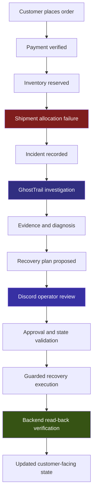
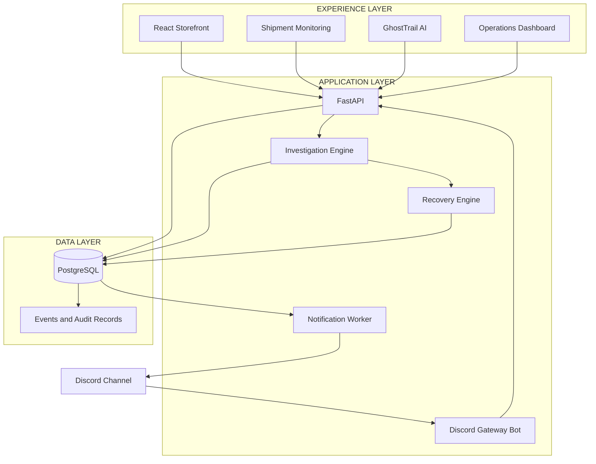

# ⚡ AFTERMATH AI
### When workflows fail, recovery begins.

**An intelligent commerce resilience platform that investigates failures, coordinates recovery, and verifies outcomes — so one failed service doesn't become a failed customer experience.**

<p align="center">
  
  
  
  
  
</p>

<p align="center">
  <a href="#-the-problem">Problem</a> •
  <a href="#-the-solution">Solution</a> •
  <a href="#-how-it-works">Workflow</a> •
  <a href="#-platform-features">Features</a> •
  <a href="#-architecture">Architecture</a> •
  <a href="#-getting-started">Setup</a>
</p>

---

## 🌍 The Problem

Imagine this:

A customer places an order. The payment succeeds. Inventory gets reserved. But the shipping service times out before creating the shipment.

Now what?

- The customer has paid, but their order is stuck.
- The payment system says success.
- The shipping system says failure.
- Inventory remains reserved.
- The operations team has to investigate multiple systems manually.

A blind retry could create duplicate shipments, inconsistent records, or even financial losses.

**The real problem isn't just detecting failure. It's recovering from failure without creating another one.**

## 💡 The Solution — Aftermath AI

Aftermath AI acts as an intelligent recovery layer between commerce systems and the people responsible for keeping them running.

Instead of simply reporting errors, it connects business evidence, reconstructs what happened, recommends a safe recovery action, and verifies the resulting state.

Its central principle:

> **Evidence before assumptions. Approval before consequential actions. Verification before declaring success.**

## 🔄 How It Works

Aftermath follows a connected six-stage recovery workflow.

| Stage | Component | Responsibility |
|---|---|---|
| 01 | Failure Detection | Identifies the seeded shipment failure and records an incident. |
| 02 | GhostTrail AI | Investigates the order and gathers available business evidence. |
| 03 | Diagnosis Engine | Produces an advisory diagnosis and recovery proposal. |
| 04 | Discord Control Room | Allows operators to inspect the case and review current state. |
| 05 | Recovery Engine | Executes the approved, guarded simulated recovery. |
| 06 | Verification | Reads persisted records again before confirming the result. |

### The complete workflow



---

## 🚀 Platform Features

### 🛍️ 01 — Commerce Storefront

A working test-commerce experience that creates the business scenario for the recovery engine.

- Five-product technology storefront.
- Interactive shopping cart and inventory validation.
- Razorpay Test Mode checkout.
- Server-side payment verification.
- Persistent order and inventory records.

### 👻 02 — GhostTrail AI

**The investigation intelligence behind Aftermath.**

GhostTrail is designed to turn scattered business records into an understandable incident investigation.

- Collects order, payment, inventory and shipment evidence.
- Reconstructs the available incident timeline.
- Generates an advisory diagnosis.
- Prepares a recovery proposal.
- Creates a time-limited handoff to Discord.

### 🎛️ 03 — Operations Dashboard

A dedicated operational view for understanding what is happening across incidents.

- Incident overview and status.
- Incident-level investigation details.
- Recovery plan visibility.
- Event timeline.
- Audit history.
- Automatic periodic data refresh.

### 🤖 04 — Discord Recovery Control Room

Recovery decisions are handled through a dedicated Discord bot workflow.

| Command | Function |
|---|---|
| `CASE <code>` | Inspect the incident and proposed recovery. |
| `STATUS <code>` | Read the latest persisted business state. |
| `CONFIRM <code>` | Approve and execute an eligible simulated recovery. |

**Safety mechanisms include:**

- Time-limited recovery handoff codes.
- Explicit operator approval.
- Payment and shipment precondition checks.
- Idempotency protection.
- Persistent audit records.
- Read-back verification after execution.

### 📦 05 — Customer Shipment Monitoring

Customers receive a simpler view of their order without being exposed to internal recovery operations.

- Order and product details.
- Shipment status.
- Recorded event timeline.
- Recovery status.
- Clear distinction between confirmed and pending milestones.

---

## 🏗️ Architecture

Aftermath separates the customer experience, investigation services, recovery operations and persistent business state.



### Technology Stack

| Category | Technology |
|---|---|
| Frontend | React, Vite, JavaScript, CSS |
| Backend | Python, FastAPI |
| Database | PostgreSQL, SQLAlchemy |
| Payment | Razorpay Test Mode |
| Operations | Discord.py, Discord Gateway |
| API | REST, OpenAPI, Swagger |
| Background Processing | Python notification worker |
| Testing | Pytest |
| Version Control | Git, GitHub |

---

## 🛡️ Reliability by Design

Recovery systems must be careful about what they claim and what they execute.

Aftermath demonstrates several important reliability principles:

- **Evidence-based investigation:** Decisions are grounded in persisted business records.
- **Explicit approval:** Consequential recovery requires an operator confirmation.
- **Precondition validation:** Business state is checked before execution.
- **Idempotent execution:** Repeated confirmation does not create duplicate recovery actions.
- **Auditability:** Decisions and actions are recorded.
- **Read-back verification:** Recovery is reported as successful only after the expected persisted state is checked again.

---

## 🎬 Demo Walkthrough

The best way to understand Aftermath is to follow one order through the complete recovery scenario.

1. Open the storefront and add products to the cart.
2. Complete checkout using Razorpay Test Mode.
3. Observe the deliberately seeded shipment-allocation failure.
4. Open Shipment Monitoring to inspect the order and incident.
5. Open GhostTrail AI to review the investigation and recovery proposal.
6. Switch to Discord and execute `CASE <code>`.
7. Run `STATUS <code>` to inspect the current state.
8. Run `CONFIRM <code>` to approve and execute the simulated recovery.
9. Run `STATUS <code>` again to verify the result.
10. Return to Shipment Monitoring and inspect the updated state.

**The important demonstration is not simply that recovery executes. It is that the system checks, approves, executes and verifies the action before reporting success.**

---

## ⚙️ Getting Started

### Prerequisites

- Python 3.11+
- Node.js and npm
- PostgreSQL
- Razorpay Test Mode credentials
- Discord bot credentials (for the Discord workflow)

### 1. Clone the repository

```bash
git clone https://github.com/ayush2459/Aftermath-AI.git
cd Aftermath-AI
git checkout phase-3/ai-investigation-recovery
```

### 2. Set up PostgreSQL

```bash
createdb aftermath_ai
psql -d aftermath_ai -f database/schema.sql
psql -d aftermath_ai -f database/razorpay_test_mode_migration.sql
```

For an existing database, check `database/README.md` and apply only the migrations that are still required.

### 3. Start the backend

```bash
cd backend

python3 -m venv .venv
source .venv/bin/activate

pip install -r requirements.txt
cp .env.example .env
```

Configure your database and Razorpay Test Mode values in `backend/.env`.

Start FastAPI:

```bash
python -m uvicorn app.main:app --reload --host 127.0.0.1 --port 8000
```

### 4. Start the frontend

In a separate terminal:

```bash
cd frontend

npm ci
cp .env.example .env

npm run dev
```

Open the local URL displayed by Vite.

### 5. Start the background services

Run these in separate terminals using the backend virtual environment.

**Notification worker**

```bash
cd backend
source .venv/bin/activate
python -m app.notification_worker
```

**Discord recovery bot**

```bash
cd backend
source .venv/bin/activate
python -m app.discord_recovery_agent
```

Configure the required Discord variables in `backend/.env`. Keep all credentials out of the frontend and never commit secrets.

### Application Routes

| Application | Route |
|---|---|
| Storefront | `/` |
| Shipment Monitoring | `/shipments` |
| GhostTrail AI | `/investigation` |
| Operations Dashboard | `/operations` |
| API Health | `/health` |
| Swagger Documentation | `/docs` |

---

## 📁 Project Structure

```text
Aftermath-AI/
│
├── backend/
│   ├── app/
│   │   ├── main.py
│   │   ├── shipments.py
│   │   ├── investigation.py
│   │   ├── recovery.py
│   │   ├── discord_recovery.py
│   │   ├── discord_recovery_agent.py
│   │   ├── notification_worker.py
│   │   └── operations.py
│   └── tests/
│
├── frontend/
│   └── src/
│       ├── App.jsx
│       ├── GhostTrail.jsx
│       └── Operations.jsx
│
├── database/
│   ├── schema.sql
│   └── migrations/
│
└── README.md
```

---

## 🔭 Future Roadmap

Aftermath is designed to grow beyond the initial recovery scenario.

| Area | Future direction |
|---|---|
| Autonomous investigation | Durable background investigation workers |
| Integrations | Real payment, inventory and carrier provider adapters |
| Event ingestion | Webhooks and change-data-capture pipelines |
| Intelligence | More advanced AI-assisted diagnosis and recommendations |
| Recovery | Provider-backed retry and compensation workflows |
| Observability | Live event streaming and deeper operational metrics |
| Scale | Production deployment and resilience testing |

---

## ⚠️ Current Scope and Limitations

Aftermath is a working prototype demonstrating a deliberately constrained, simulated recovery workflow.

- The current automated failure is a seeded shipment-allocation timeout, not a universal detector for arbitrary external commerce systems.
- GhostTrail investigation and recovery-plan preparation are initiated by opening the investigation page; a durable autonomous investigation worker is not yet implemented.
- Recovery execution is a guarded database simulation. No live carrier API is contacted and no physical parcel is created or moved.
- The Operations Dashboard uses periodic polling rather than WebSockets or server-sent events.
- Discord approval, precondition checks, idempotency, audit and read-back verification apply to the seeded demo scenario.
- Razorpay is used in Test Mode; the demo does not process real payments.

These limitations define the current prototype scope. Production deployment would require provider integrations, reconciliation logic, additional resilience testing and operational hardening.

---

## 🤝 Contributing

Ideas and feedback are welcome.

1. Fork the repository.
2. Create a feature branch.
3. Implement and test your changes.
4. Submit a pull request with a clear explanation.

## 📄 License

No license is currently specified. Contact the repository owner before redistributing or reusing this project beyond GitHub's default terms.

---

<div align="center">

# AFTERMATH AI

### Failure is inevitable. Uncontrolled recovery isn't.

**Built to make commerce workflows more resilient.**

[Explore the Repository](https://github.com/ayush2459/Aftermath-AI)

</div>
